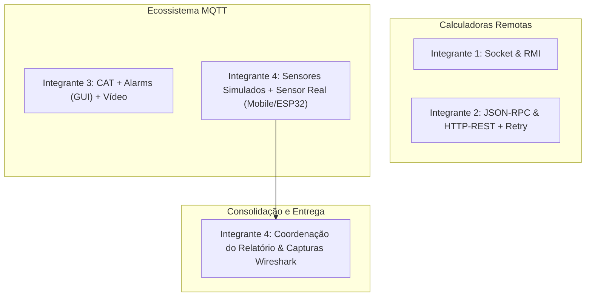

# 📋 Plano de Trabalho e Execução: Atividade AT03 (Calculadora Distribuída & MQTT)

**Disciplina:** CKP7500 - Sistemas Distribuídos e Redes de Comunicação (Mestrado / Pós-Graduação)  
**Professores:** Prof. Windson Viana de Carvalho e Prof. Fernando Antonio Mota Trinta  
**Data Limite de Entrega:** 30 de Outubro  
**Formato de Equipe:** 4 Integrantes  
**Pontuação Total:** 10,0 Pontos (1,0 Individual no Forms + 9,0 Grupo: 7,0 Implementações/Vídeo + 2,0 Relatório)

---

## ⚠️ Alertas Críticos & Regras Específicas

> [!CAUTION]
> **EXCLUSIVO PARA ALUNOS DA PÓS-GRADUAÇÃO:**  
> No projeto MQTT, **pelo menos um sensor de temperatura DEVE SER REAL** (ex.: aplicativo MQTT no smartphone publicando dados de sensores internos/bateria/temperatura ou hardware físico como ESP32/ESP8266/Arduino).

> [!IMPORTANT]
> **COMENTÁRIOS OBRIGATÓRIOS NAS LINHAS DE CÓDIGO:**  
> A especificação exige explicitamente: *"deve comentar cada linha do código das classes de comunicação indicando o que a linha de comando faz"*. Não cometer o erro de deixar métodos de rede sem comentários linha a linha!

> [!NOTE]
> **REQUISITO DAS DUAS ABORDAGENS DE EXPRESSÕES ARITMÉTICAS:**  
> As 4 calculadoras (Socket, RMI, JSON-RPC e HTTP-REST) devem suportar expressões como `(10 + 15) * 4` de **duas formas**:
> 1. **Abordagem 1 (Decomposição no Cliente):** O cliente analisa a expressão (ex: Shunting-yard / AST / regex) e faz chamadas remotas individuais sucessivas ao servidor para cada operação básica.
> 2. **Abordagem 2 (Cálculo no Servidor):** O cliente envia a string da expressão inteira para o servidor calcular remotamente e retornar o resultado final.

---

## 👥 Divisão da Equipe (4 Integrantes)

Para garantir máxima produtividade sem gargalos, as responsabilidades são divididas por afinidade arquitetural e paridade de carga de trabalho:



### 🧑‍💻 Integrante 1: Módulos Sockets & RMI (Calculadoras)
* **Sockets (0,5 pt):**
  * Evoluir `ClientSocket` e `ServerSocket` para suportar `+`, `-`, `*`, `/`.
  * Implementar interface gráfica mínima (CLI estruturado ou GUI Swing/JavaFX/Web).
  * Implementar as duas abordagens de expressão (decompõe no cliente vs envia string completa).
  * Comentar cada linha de rede/comunicação.
* **Java RMI / Pyro (0,5 pt):**
  * Evoluir interface remota, objeto remoto (`RemoteImpl`), Server e Client.
  * Suporte às 4 operações e às 2 abordagens de expressões matemáticas.
  * Comentar cada linha de invocação e registro RMI (`Naming.rebind`, `lookup`, etc.).
* **Entrega Técnica:**
  * Códigos comentados, repositórios/pastas organizadas.
  * Captura de tráfego no **Wireshark** (fluxo TCP/Socket e handshake/RMI) com descrição dos pacotes.

---

### 🧑‍💻 Integrante 2: Módulos JSON-RPC & HTTP-REST + Retry (Calculadoras)
* **JSON-RPC (1,0 pt):**
  * Implementar/evoluir servidor e cliente JSON-RPC (usando rpcKTOR ou biblioteca em Python/Node/Java).
  * Tratar chamadas remotas de `+`, `-`, `*`, `/` e os 2 modos de expressões matemáticas.
  * Comentar cada linha dos endpoints e serialização RPC.
* **HTTP-REST Simples + Retry Policy (2,0 pts):**
  * **Servidor (0,5 pt):** Endpoint que recebe requisições via `POST` e calcula as operações.
  * **Cliente (0,5 pt):** Cliente HTTP que invoca o serviço com as 4 operações e os 2 modos de expressões.
  * **Política de Retry (1,0 pt):** Implementar no cliente lógica resiliente com tempo de espera e retentativas (ex.: *Wait Ts and Retry* com Exponential Backoff e jitter ou limite de retries configurável).
  * Comentar cada linha de comunicação HTTP.
* **Entrega Técnica:**
  * Códigos comentados.
  * Demonstração prática da política de Retry (desligando o servidor para mostrar as tentativas).
  * Captura de tráfego no **Wireshark** (pacotes JSON-RPC e HTTP POST/Retry).

---

### 🧑‍💻 Integrante 3: Core MQTT (CAT, Alarms com GUI e Vídeo)
* **Serviço CAT - Compute Average Temperature (Parte dos 1,5 pts do MQTT):**
  * Subscrito no tópico de temperatura dos sensores (`sensor/temperature/+`).
  * Armazena leituras em janela temporal deslizante dos **últimos 120 segundos**.
  * Calcula a média periodicamente ou a cada nova mensagem.
  * Publica mensagens de evento específicas:
    1. `aumento de temperatura repentina`: disparada se as duas últimas médias diferirem em $\ge 5^\circ\text{C}$.
    2. `temperatura alta`: disparada se a média atual for superior a $200^\circ\text{C}$.
* **Serviço Alarms com Interface Gráfica (Parte dos 1,5 pts + 0,5 pt bônus):**
  * Subscrito nos tópicos de alarme do serviço CAT.
  * Interface Gráfica (ex.: Desktop em JavaFX/Swing/Tkinter/PyQt ou Web Dashboard em React/Vite/WebSocket):
    * Exibição visual destacada dos alertas (ex.: cartões vermelhos/amarelos sonoros ou visuais para Fogo, Temperatura Alta, Variação Brusca).
    * Histórico e log de alarmes em tempo real.
* **Gravação do Vídeo de Demonstração (1,0 pt):**
  * Roteirizar e gravar vídeo curto (3 a 5 min) demonstrando:
    1. Sensores simulados e reais publicando no Broker.
    2. Serviço CAT recebendo payloads e recalculando a média de 120s.
    3. Simulação de anomalia gerando os dois tipos de alarme na GUI do serviço Alarms.
  * Subir vídeo no GitHub (ou link do YouTube não-listado no README do repo).
* **Entrega Técnica:**
  * Códigos do CAT e Alarms comentados.
  * Vídeo gravado e linkado no repositório.

---

### 🧑‍💻 Integrante 4: Sensores MQTT (Simulado + REAL da Pós) & Relatório Comparativo
* **Simulador de Sensores MQTT (Parte dos 1,5 pts do MQTT):**
  * Script/aplicação configurável para simular múltiplos nós sensores (número de sensores ajustável dinamicamente).
  * Publicação a cada 60s (com opção de acelerar em modo de teste para facilitar validação).
  * Geração de curvas de temperatura normais (ex: 80°C - 120°C) e injeção controlada de picos (> 200°C ou saltos > 5°C) para testar os alarmes.
* **Sensor REAL da Pós-Graduação (Obrigatório Pós):**
  * Implementação de 1 sensor real:
    * **Opção Mobile (Mais rápida e viável):** App de smartphone (ex.: MQTT Dashboard, IoT MQTT Panel ou script Python no Termux) publicando leituras reais de sensores do celular (bateria, giroscópio ou temperatura ambiente) convertidos para a escala de teste.
    * **Opção Hardware (Se disponível na equipe):** ESP32 / ESP8266 com sensor DHT11/DHT22 ou LM35 publicando no Broker.
* **Coordenação & Redação do Relatório Comparativo (2,0 pts):**
  * Criação do template do relatório (limite máximo de 8 páginas).
  * Elaboração dos diagramas comparativos das arquiteturas (Mermaid / Draw.io).
  * Consolidação das capturas de tráfego do Wireshark de todos os integrantes.
  * Redação da análise comparativa:
    * Interoperabilidade
    * Desacoplamento (Espacial, Temporal e de Sincronização)
    * Desempenho / Overhead de Rede (tamanho de frames, headers, payload)
    * Cenários de aplicação recomendados para cada tecnologia.
* **Entrega Técnica:**
  * Código do simulador e documentação do sensor real.
  * PDF final do relatório pronto para submissão no SIGAA.

---

## 🏗️ Estrutura Recomendada do Repositório

```plaintext
atv-3-sd/
├── PLANO_DE_TRABALHO.md                     # Este documento de acompanhamento
├── docs/
│   ├── relatorio_comparativo.pdf            # Relatório final (máx 8 páginas)
│   ├── diagramas/                           # Arquiteturas e fluxos
│   └── wireshark/                           # Capturas .pcapng e prints anotados
│       ├── 01_socket.pcapng
│       ├── 02_rmi.pcapng
│       ├── 03_jsonrpc.pcapng
│       ├── 04_rest_retry.pcapng
│       └── 05_mqtt.pcapng
├── 01_calculadora_socket/                   # Integrante 1
│   ├── server/
│   ├── client/
│   └── README.md
├── 02_calculadora_rmi/                      # Integrante 1
│   ├── server/
│   ├── client/
│   ├── shared_interfaces/
│   └── README.md
├── 03_calculadora_jsonrpc/                  # Integrante 2
│   ├── server/
│   ├── client/
│   └── README.md
├── 04_calculadora_rest/                     # Integrante 2
│   ├── server/                              # Servidor HTTP (POST)
│   ├── client/                              # Cliente HTTP com Retry
│   └── README.md
└── 05_monitoramento_mqtt/                   # Integrantes 3 e 4
    ├── broker/                              # Instruções / docker-compose Mosquitto
    ├── sensor_simulado/                     # Gerador dinâmico de sensores
    ├── sensor_real_pos/                     # Instruções e scripts do sensor real
    ├── servico_cat/                         # Compute Average Temperature
    ├── servico_alarms_gui/                  # Dashboard com alarmes visuais
    ├── video/                               # Link/arquivo do vídeo de demonstração
    └── README.md
```

---

## 🔬 Plano de Captura no Wireshark (Para o Relatório)

Para cada um dos 5 paradigmas, capturar e documentar:

| Paradigma | Filtro Wireshark Recomendado | Aspectos a Evidenciar no Relatório |
| :--- | :--- | :--- |
| **1. Sockets** | `tcp.port == <porta_socket>` | Três vias do TCP (SYN, SYN-ACK, ACK), payload bruto trafegado, encerramento de conexão (FIN). |
| **2. RMI** | `tcp.port == 1099 || tcp.port == <porta_obj>` | Registro no `rmiregistry`, serialização binária Java/Pyro, overhead de cabeçalhos de invocação remota. |
| **3. JSON-RPC** | `http || tcp.port == <porta_rpc>` | Formato da mensagem JSON (`jsonrpc: "2.0"`, `method`, `params`, `id`), resposta com `result` ou `error`. |
| **4. HTTP-REST + Retry** | `http.request.method == "POST"` | Cabeçalhos HTTP, status codes (200 OK, 500/503 em simulação de falha), retransmissões do mecanismo de Retry com intervalo de espera visível no timestamp. |
| **5. MQTT** | `mqtt` | Pacotes `CONNECT`, `CONNACK`, `SUBSCRIBE`, `SUBACK`, `PUBLISH` com seus tópicos e payloads (QoS 0/1/2), mostrando o desacoplamento pelo broker. |

---

## 📑 Estrutura Sugerida do Relatório Comparativo (Máx. 8 Páginas)

* **Página 1:** Capa, identificação dos alunos (Pós-Graduação), links dos repositórios GitHub e link do vídeo MQTT.
* **Página 2:** Diagramas de arquitetura comparativos (Comunicação Direta vs Indireta, Cliente-Servidor vs Publish-Subscribe).
* **Página 3:** Análise do paradigma Socket (Arquitetura, código comentado, evidências Wireshark).
* **Página 4:** Análise do paradigma RMI e JSON-RPC (Invocação remota, semântica, serialização, capturas Wireshark).
* **Página 5:** Análise do paradigma HTTP-REST e mecanismo de Retry (Resiliência, idempotência, capturas Wireshark das retentativas).
* **Página 6:** Análise da Arquitetura MQTT (Desacoplamento temporal/espacial, Broker, Serviço CAT, Alarms, Sensor Real).
* **Página 7:** Tabela e Análise Comparativa Global:
  * *Interoperabilidade* (RMI vs REST vs JSON-RPC vs MQTT)
  * *Desacoplamento* (Espacial, Temporal, Sincronização)
  * *Overhead e Desempenho* (Tamanho de payload nas capturas)
  * *Tolerância a Falhas e Cenários Ideais*
* **Página 8:** Conclusões e Referências bibliográficas (Coulouris Cap. 6, Tanenbaum, documentação OASIS MQTT).

---

## 📅 Cronograma Sugerido até 30 de Outubro

| Período | Meta / Entregável | Responsável Principal |
| :--- | :--- | :--- |
| **Dia 1 (Imediato)** | Responder ao Questionário Individual no Forms (1,0 pt) | **Todos (Individual)** |
| **Dias 2 - 3** | Setup dos projetos base das calculadoras (Socket, RMI, JSON-RPC, REST) | Integrantes 1 e 2 |
| **Dias 2 - 3** | Subir Broker MQTT (Mosquitto) e implementar simulador + sensor real | Integrante 4 |
| **Dias 4 - 5** | Implementar expressões matemáticas (Abordagens 1 e 2) e Retry no REST | Integrantes 1 e 2 |
| **Dias 4 - 5** | Implementar serviço CAT (janela 120s) e Alarms com GUI | Integrante 3 |
| **Dia 6** | Realizar todas as capturas do Wireshark e exportar arquivos `.pcapng` | Integrantes 1, 2, 4 |
| **Dia 7** | Gravar vídeo de demonstração do ecossistema MQTT e subir no GitHub | Integrante 3 |
| **Dia 8** | Redigir relatório comparativo (até 8 págs) com diagramas e capturas | Integrante 4 + Revisão Geral |
| **Dia 9 (30/10)** | Revisão de checklist de entrega e submissão no SIGAA | **Todos** |

---

## ✅ Checklist de Validação Pré-Submissão

- [ ] Todos os 4 integrantes responderam individualmente ao Google Forms (1 pt)?
- [ ] Todas as 4 calculadoras possuem operações básicas (`+`, `-`, `*`, `/`)?
- [ ] Todas as 4 calculadoras suportam as 2 formas de expressões aritméticas (no cliente vs no servidor)?
- [ ] Todas as classes de comunicação possuem **comentários linha a linha** explicando cada instrução de rede?
- [ ] O cliente HTTP-REST possui uma política de Retry implementada e demonstrável?
- [ ] O serviço CAT calcula a média dos últimos 120 segundos e dispara os dois tipos de aviso ($\Delta \ge 5^\circ\text{C}$ e $> 200^\circ\text{C}$)?
- [ ] O serviço Alarms possui interface gráfica com monitoramento dos alarmes (+0,5 pt)?
- [ ] Há pelo menos **um sensor real** conectado ao MQTT (exclusivo Pós-Graduação)?
- [ ] O vídeo demonstrando sensores, CAT e Alarms está gravado e acessível no repositório (+1,0 pt)?
- [ ] Foram feitas as capturas de tráfego no Wireshark para os 5 modelos de comunicação?
- [ ] O relatório comparativo possui no máximo 8 páginas e aborda interoperabilidade, desacoplamento, desempenho e cenários adequados?
- [ ] O PDF do relatório foi submetido no SIGAA dentro do prazo?
